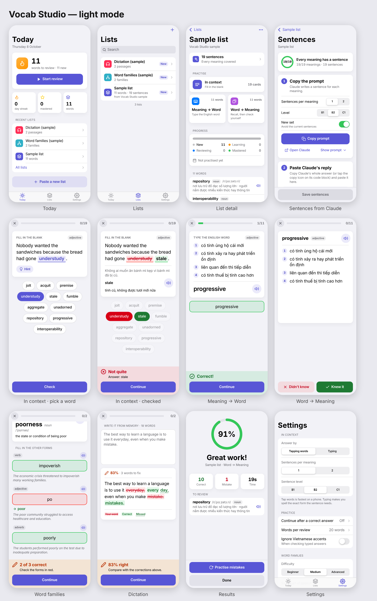

# Vocab Studio

An iPhone-first web app for learning English vocabulary **in context**. Paste the
word lists you collect from books, news and podcasts, have Claude write
fill-in-the-blank sentences for every meaning, and practise a few minutes a day.
Installs to the Home Screen and works fully offline.



It combines the best parts of five earlier practice apps (Practice-full-English-vocabs,
Practice-new-terms, English-definition, Practice-derivatives, Practice-foreign-sentences)
into one polished app.

## What it does

- **Reads your lists as you write them**: numbered words with part of speech,
  optional IPA and Vietnamese meanings split on `i) ii) iii)`, plus the
  `Definition: / Example: / Word family: / Synonyms:` block format, word-family
  blocks and plain passages.
- **In context**: fill-in-the-blank sentences for every meaning of every word.
  Answer by tapping a word bank or by typing the exact form. Hints, a Vietnamese
  translation after each answer, and the sentence read aloud.
- **Meaning → Word**: type the English word from its meanings, with letter hints.
- **Word → Meaning**: flashcards you grade yourself.
- **Word families**: fill in every form, with three difficulty levels.
- **Dictation**: memorise a passage (or only hear it) and write it from memory.
  Word-by-word corrections that handle missing and extra words properly.
- **Spaced repetition**: wrong answers come back in the same session, and every
  word is scheduled for review (1, 3, 7, 14, 30 days). The Today tab shows what is due.
- Pronunciation with the iPhone's built-in voices, light/dark mode, backup and
  restore, resume after the phone closes the app.

Dark mode: [docs/screenshots-dark.png](docs/screenshots-dark.png)

## How the sentences are made

Your lists have meanings but no English sentences, so the app asks Claude — using
the Claude app you already have, with no API key:

1. Open a list → **Make sentences** → **Copy prompt**.
2. Paste it into a new chat in the Claude app and send.
3. Copy Claude's whole reply (or tap the copy button on its code block).
4. Back in Vocab Studio, tap **Paste reply** → **Save**.

The sentences are stored with the list, so practice works offline afterwards.
**New set** asks for fresh sentences so you learn the words, not the sentences.

## Put it on your iPhone

The app is a static website — no server code. To host it free on GitHub Pages:

1. Upload this folder to a **public** GitHub repository (e.g. `english-vocab-studio`).
2. In the repository: **Settings → Pages → Build and deployment → Source:
   Deploy from a branch**, choose `main` and `/ (root)`, then **Save**.
3. After a minute the site is live at
   `https://<your-username>.github.io/english-vocab-studio/`.
4. Open that address in **Safari** on the iPhone, tap **Share** →
   **Add to Home Screen** → **Add**. Open it from the new icon.

Your lists are stored only on the phone (IndexedDB). Use **Settings → Export
backup** now and then to save a copy in Files or iCloud Drive.

## Development

No build step and no dependencies. Node 22+ is only needed for tests and tools.

```sh
node tools/serve.mjs 8080        # serve the app at http://localhost:8080
npm test                         # unit tests (node:test)
node tools/update-sw.mjs         # refresh the offline cache list + version (run after every change)
node tests/e2e/flows.mjs         # end-to-end flows (needs Playwright + Chromium and the dev server)
node tools/make-icons.mjs        # re-render the PNG icons from icons/icon.svg (needs Playwright)
```

**After changing any app file, run `node tools/update-sw.mjs`** — the service
worker version is a hash of the shipped files, and installed apps only update
when it changes (they then show an "Update" button).

See [docs/architecture.md](docs/architecture.md) for the data model, module
contracts and input formats.

## Project layout

```
index.html, manifest.webmanifest, sw.js   app shell, install metadata, offline cache
css/app.css, css/screens/*.css            design system + per-screen styles
js/core/                                  pure logic (parsing, grading, sentences, spaced repetition)
js/data/                                  IndexedDB storage, sample content
js/ui/                                    DOM helpers, components, router, keyboard, speech
js/screens/                               screens; js/screens/practice/ = practice engine + modes
tests/unit, tests/e2e, tests/fixtures     tests and sample inputs
tools/                                    dev server, service-worker updater, icon renderer
```

## License

MIT
